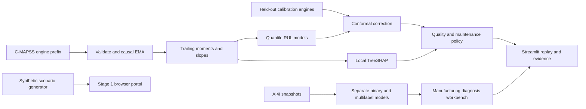
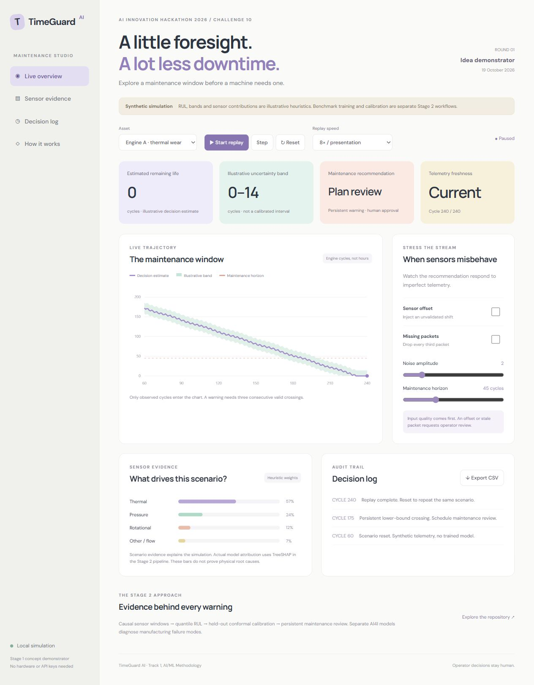

# TimeGuard AI

**A maintenance decision workbench for sensor streams: remaining life, uncertainty, and an auditable reason to act.**

AI Innovation Hackathon 2026 · Track 1: AI/ML Methodology · Challenge 10: TimeGuard AI — Predicting Machine Failure from Sensor Streams · Intermediate to Advanced

## Team

- Team name: Unseen
- Members: **[Name — role]**, **[Name — role]**, **[Name — role]**, **[Name — role]**
- Repository: https://github.com/likhithayepalagunta-19/TimeGuardAI

## Current delivery status

The Stage 1 portal is a working, deterministic **synthetic simulation**, with replay, perturbation controls, maintenance policy, event log, and export. Its RUL bands and sensor contribution bars are illustrative heuristics, not fitted conformal intervals or SHAP values. Actual benchmark training/evaluation has now completed. Measured results and limitations appear in [BENCHMARK_RESULTS.md](docs/BENCHMARK_RESULTS.md) and machine-readable `reports/`. Trained weights are local artifacts, excluded from Git. No industrial deployment or downtime reduction is claimed.

## Problem description

Factories need enough warning to schedule maintenance without repeatedly stopping healthy machines. A late RUL estimate can cause an avoidable outage. An early warning can waste useful component life. Noisy measurements, changing operating conditions, missing packets and correlated sensor channels make a single confident prediction unsafe. Operators also need to know which measurements influenced the forecast and when the model has left its validated operating envelope.

## Proposed solution

TimeGuard combines a cost-sensitive RUL forecast, a separately calibrated prediction interval, telemetry quality checks, and a stateful alert policy. A replay engine presents measurements in cycle order using only the prefix available at each step. A separate AI4I workbench identifies overlapping failure modes for its own manufacturing domain. These models share a user interface and output contract, **not training rows or a universal machine identity**.

## Key features

- Pastel browser portal with play/pause, step, reset, speed control, asset selection and CSV evidence export.
- Synthetic thermal/load scenarios with missing-packet, noise and offset controls. Each simulation labels its provenance.
- Causal EMA and trailing-window statistics for real C-MAPSS trajectories.
- Gradient-boosted quantiles at 0.05, 0.50, 0.95 and a conservative 0.20 decision estimate.
- Split conformalized quantile regression using engines held out from model fitting.
- Separate AI4I binary failure and five-label failure-mode classifiers.
- Local TreeSHAP attribution available for a fitted RUL model, with physical group mapping as an operator aid rather than causal proof.
- Quality gates and persistence/hysteresis in the simulation policy, an explicit review state, and human maintenance approval.

## Technology stack

Python, NumPy, pandas, SciPy, scikit-learn, SHAP, joblib, Streamlit and Plotly. The lightweight Stage 1 portal uses HTML, CSS and vanilla JavaScript, works offline, and requires no API keys. CPU training is the default. PyTorch TCN is a stretch experiment, not a required dependency.

## Architecture and workflow



## Methodology

1. Split C-MAPSS FD001 by engine into fitting/calibration/validation groups using seed 42. Fit all transforms on the fitting partition. Never randomly split overlapping windows.
2. Derive `raw_rul = last_cycle - cycle`, train on `min(raw_rul,125)`. Use both clipped and raw endpoint evaluation labels and identify which protocol each table uses.
3. Keep a predefined FD001 sensor subset and compute last, trailing mean, standard deviation, slope, min and max after causal EMA. Train only after a complete 30-cycle history. No centered smoothing, backward filling or future engine lifespan enters inference features.
4. Fit separate boosted quantile regressors. With overestimation cost four times underestimation cost, the optimal quantile for piecewise linear cost is `tau=1/(4+1)=0.20`. This is a decision estimate, separate from median accuracy and uncertainty.
5. Fit conformal correction on one preregistered random prefix endpoint per calibration engine. Score `max(q05-y,y-q95,0)`. Use rank `ceil((n+1)*0.9)`. If rank exceeds n, return an infinite interval and abstain. This supports marginal coverage only under suitable exchangeability of calibration and evaluation endpoints. Coverage is not assured under drift or for every engine/time step.
6. Train AI4I on six physical/type inputs and engineered temperature gap, mechanical power and wear-load product. Exclude IDs, machine failure and all mode labels from inputs. Five modes may co-occur, so use multilabel targets rather than a single softmax. RNF has no predictable physical signal by construction.
7. Evaluate final official C-MAPSS test endpoint per engine once. Use untouched AI4I holdout data, report minority-label support, PR-AUC and per-mode recall. Tune any thresholds on validation only.

Full schemas, download commands, protocol details, ablations and risks: [research dossier](docs/TECHNICAL_DOSSIER.md).

## Repository structure

```text
TimeGuardAI/
  README.md
  requirements.txt
  .gitignore
  portal/                 # no-build Stage 1 portal
    index.html
    app.js
    styles.css
  app/streamlit_app.py     # actual fitted C-MAPSS replay when weights exist
  app/pages/2_Manufacturing_diagnosis.py
  src/timeguard/
    __init__.py
    features.py           # causal feature contract
    conformal.py          # finite-sample order statistic
    policy.py             # stateful warning policy
    metrics.py
  scripts/
    download_data.py
    train.py
    explain.py
  tests/test_core.py
  models/README.md         # generated weights are not checked in
  data/README.md           # external raw data ignored
  reports/                # generated evaluation JSON
  docs/
    TECHNICAL_DOSSIER.md
    STAGE1_SUBMISSION.md
    STAGE2_SUBMISSION.md
    DEMO_SCRIPT.md
    presentation/         # editable PPTX and PDF
```

## Local working folder and deliverables

The canonical checkout is `C:\Users\likhi\OneDrive\Documents\TimeGuard`. Its `origin` remote is the repository above. Work from that folder, not the earlier chat staging directory.

- Double-click `RUN_DEMO.cmd` for the independent Stage 1 portal.
- Double-click `RUN_STREAMLIT.cmd` for the trained-model workbench after installing requirements.
- [Final editable presentation](docs/presentation/TimeGuardAI_Stage1_Final.pptx)
- [Final presentation PDF](docs/presentation/TimeGuardAI_Stage1_Final.pdf)
- [Stage 1 screening responses](docs/STAGE1_SUBMISSION.md)
- [Stage 2 submission copy](docs/STAGE2_SUBMISSION.md)
- [Technical dossier and dataset schemas](docs/TECHNICAL_DOSSIER.md)
- [UI image ZIP](docs/screenshots/TimeGuard_UI_Images.zip)

Raw data, generated weights and `.venv` exist locally and are ignored by Git. Other clones reproduce them using download/training commands. GitHub tracks source, reports, documents, slides and screenshots.

## Installation

Requires Python 3.10+ and a modern browser. Start in the repository root.

```powershell
git clone https://github.com/likhithayepalagunta-19/TimeGuardAI.git
cd TimeGuardAI
python -m venv .venv
.\.venv\Scripts\Activate.ps1
python -m pip install -r requirements.txt
```

## Usage

### Stage 1, no installation

Open `portal/index.html` in a browser, or serve it:

```powershell
python -m http.server 8765 --directory portal
```

Visit http://localhost:8765. Select an asset, start replay and toggle sensor offset or missing packets. Export an evidence CSV. All numerical outputs in this portal are synthetic illustrations.

### Stage 2, benchmark-backed workbench

```powershell
python scripts/download_data.py --dataset all
python scripts/train.py --task rul
python scripts/train.py --task modes
python -m pytest -q
streamlit run app/streamlit_app.py
python scripts/explain.py --engine 1
```

Downloads require internet access. The loader validates ZIP structure and writes SHA256 provenance. Failed downloads stop explicitly rather than substituting synthetic training data. If a NASA redirect is unavailable, obtain the original C-MAPSS archive from the NASA repository and extract `train_FD001.txt`, `test_FD001.txt` and `RUL_FD001.txt` under `data/raw/cmapss/`. Generated weights are under `models/`, metrics under `reports/`. The Streamlit workbench requires trained RUL weights and fails visibly if absent. Never load untrusted joblib files.

## Dataset information and models

| Dataset | Use | Model | Important boundary |
|---|---|---|---|
| NASA C-MAPSS FD001 | Sequential RUL, official endpoint evaluation | Boosted quantiles + squared-error baseline | Simulated turbofans, cycles are not hours |
| UCI AI4I 2020 | Binary failure + multilabel diagnosis | Balanced random forests | Synthetic process snapshots, no valid per-machine RUL |
| FEMTO PRONOSTIA | Future external bearing validation | Not implemented | Real accelerated vibration data, separate domain |

## Results

Measured on 19 October 2026. See [full benchmark results and limitations](docs/BENCHMARK_RESULTS.md). CPU: Intel64 Family 6 Model 186 Stepping 3, Python 3.12.14, scikit-learn 1.9.1. Lower NASA S-score is better. All RUL models use the same 60 fitting engines, with 20 separate calibration and 20 validation engines.

| Measure | Squared-error baseline | TimeGuard | Protocol |
|---|---:|---:|---|
| FD001 RMSE, clipped cycles | 13.05 | 14.08 median / 15.81 decision | 100 official test endpoints |
| FD001 RMSE, raw cycles | 14.21 | 14.90 median / 17.62 decision | Uncapped evaluation labels |
| NASA S-score, raw | 308.42 | 398.78 median / 418.71 decision | Positive error means a late estimate |
| Late-estimate rate | 62% | 65% median / 28% decision | Any positive RUL overestimate |
| Nominal-90% interval coverage | N/A | 84% test / 90% validation | Official-test coverage target missed |
| Mean interval width, cycles | N/A | 54.27 | Calibrated against raw RUL |
| AI4I binary precision / recall / F1 | N/A | 94.92% / 82.35% / 88.19% | 2,000 holdout rows, 68 positives |
| AI4I mode F1 | N/A | TWF 0 / HDF .931 / PWF 1 / OSF 1 / RNF 0 | Per-mode support and PR-AUC in report |
| Four-model RUL p50 / p95, ms | N/A | 4.35 / 7.92 | Warm batch 1, excludes features/SHAP/UI |
| False-alert episodes / 1,000 cycles | Not measured | Not measured | Stateful held-out trajectory study pending |
| Simulated maintenance cost | Not measured | Not measured | Cost study pending |

The conservative decision estimate reduces late predictions but worsens RMSE and NASA score. The baseline wins on those accuracy metrics. Nominal coverage misses its test target. These limitations are part of the result, not omitted failure cases.

## Screenshots and demo

Open the Stage 1 portal for the current interactive demo. Follow [the 3-minute script](docs/DEMO_SCRIPT.md). Add an unlisted video URL and deployed URL if required by the organizer.



## Expected impact and ROI

Target hypotheses: reduce simulated decision cost by 20% against a tuned threshold baseline, meet 90% nominal interval coverage on the defined endpoint protocol, and keep model-only p95 inference under 100 ms on the declared CPU. These are acceptance targets, not results. Illustrative annual value: 10 avoided outages × 4 hours × ₹50,000/hour = ₹20 lakh gross avoided downtime. Subtract extra maintenance, false dispatches, software and deployment costs. Values require plant evidence before any ROI claim.

## Limitations and future scope

No installed factory data, live IoT connection, or validated industrial safety function. A row is one engine cycle, not a fixed wall-clock interval. FD001 contains one operating condition and one degradation mode. Correlated SHAP features can share credit and do not prove causality. The Stage 1 quality gates detect injected missingness and offset scenarios, not all distribution shifts. Current TWF and RNF recall are zero at threshold 0.5. RNF is inherently difficult. Small calibration fleets lead to unstable coverage estimates. A production roadmap includes FD002/FD004 regime normalization, multi-factory validation, authenticated MQTT/OPC-UA adapters, drift monitoring with delayed labels, model versioning and CMMS integration.

## External resources and attributions

- [NASA C-MAPSS catalog](https://data.nasa.gov/dataset/cmapss-jet-engine-simulated-data), Saxena et al., *Damage Propagation Modeling for Aircraft Engine Run-to-Failure Simulation*, PHM 2008.
- [UCI AI4I 2020](https://archive.ics.uci.edu/dataset/601/ai4i+2020+predictive+maintenance+dataset), DOI 10.24432/C5HS5C, CC BY 4.0. Synthetic data, cite the dataset and Matzka (2020).
- [NASA PCoE repository](https://www.nasa.gov/intelligent-systems-division/discovery-and-systems-health/pcoe/pcoe-data-set-repository/) for original benchmark references and terms.
- [Romano, Patterson and Candès, 2019](https://arxiv.org/abs/1905.03222), *Conformalized Quantile Regression*.
- [SHAP TreeExplainer documentation](https://shap.readthedocs.io/en/latest/generated/shap.TreeExplainer.html).
- [scikit-learn quantile model documentation](https://scikit-learn.org/stable/modules/generated/sklearn.ensemble.GradientBoostingRegressor.html).
- User-supplied SIH presentation used only for layout inspiration. SIH content, team identities and logos are not part of this submission.

Code license: team to select before reuse or redistribution. Dataset terms remain separate. AI assistance contributed to planning, documentation, code and presentation preparation. Team members must understand, verify and disclose use according to the organizer's actual rules.
