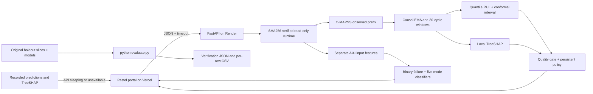

# TimeGuard AI

*Uncertainty-Aware Predictive Maintenance & Real-Time Failure Mode Diagnostics from Industrial Sensor Streams*

[](requirements.txt)
[](api/main.py)
[](scripts/train.py)
[](docs/TECHNICAL_DOSSIER.md)
[](render.yaml)
[](#limitations-and-roadmap)
[](https://time-guard-ai.vercel.app/)
[](https://github.com/likhithayepalagunta-19/TimeGuardAI/actions/workflows/tests.yml)
[](LICENSE)

**🌐 [Live Web Portal](https://time-guard-ai.vercel.app/) · ⚡ [Backend API & Swagger Docs](https://timeguard-ai-api.onrender.com/docs) · 🩺 [System Health Check](https://timeguard-ai-api.onrender.com/health)**

An end-to-end ML systems portfolio project by **[Likhitha Yepalagunta](https://github.com/likhithayepalagunta-19)**, spanning system design, model evaluation, API architecture and cloud deployment.

## Executive overview

A point estimate of remaining useful life is insufficient for maintenance planning. Overestimating life can delay intervention until a production line stops; frequent premature warnings waste component life and operator attention. Noisy sensors, missing packets and operating shifts make that decision harder.

I built TimeGuard AI as a decoupled, full-stack predictive maintenance workbench: causal telemetry features feed quantile RUL models, finite-sample conformal intervals expose uncertainty, and local TreeSHAP explains sensor contributions. A separate manufacturing model diagnoses overlapping failure modes. The interface turns those outputs into persistent, auditable maintenance recommendations while retaining human approval.

**Engineering focus:** reproducible ML artifacts, causal stream processing, uncertainty evaluation, typed inference services, resilient frontend behavior and CI-backed verification. The system is deployed publicly; factory integration remains future work.

## Architectural pillars

| Pillar | Implemented design | Engineering value |
|---|---|---|
| Risk-asymmetric RUL | NASA C-MAPSS FD001; target clipping at 125 cycles; quantile regressors at .05/.20/.50/.95 | Separates median accuracy from conservative maintenance decisions |
| Finite-sample uncertainty | Split conformal calibration on held-out engine endpoints, against raw RUL | Reports nominal 90% target alongside 84% empirical test coverage |
| Local explainability | TreeSHAP on the fitted median estimator, aggregated from temporal features to sensor IDs | Makes signed model contributions inspectable without claiming causality |
| Multi-label diagnosis | UCI AI4I binary classifier plus independent HDF, PWF, OSF, TWF and RNF classifiers | Represents concurrent manufacturing failure modes in a separate domain |
| Telemetry quality | Causal EMA, trailing windows, offset injection, packet-loss holds and review states | Exposes stale or shifted evidence instead of silently presenting certainty |
| Deployment and MLOps | FastAPI on Render, static frontend on Vercel, SHA256 artifact checks, GitHub Actions | Reproducible inference and evaluation without training at service startup |

The conservative decision uses $\tau = 0.20$, corresponding to a **4:1 late-vs-early linear error cost**. It reduces benchmark late overestimates from **65% to 28%**, while worsening RMSE and NASA score. NASA S-Score is a separate evaluation metric, not the training loss.

Conformal prediction provides a finite-sample **marginal** coverage guarantee only under its exchangeability assumptions. The observed **84%** test coverage misses the **90%** target by six percentage points; it does not establish per-machine or drift-conditioned coverage.

The TreeSHAP panel uses display aliases such as “HPT Coolant Bleed” and “HPC Outlet Pressure.” Raw C-MAPSS IDs remain in tooltips and attribution payloads. Those aliases are not validated physical metadata; the [technical dossier](docs/TECHNICAL_DOSSIER.md) retains the reference sensor schema.

## System architecture



The RUL and manufacturing models share the service boundary and interface, never training rows or assumed machine identities. Streaming behavior is implemented through ordered prefix ingestion and software replay; no physical IoT broker or factory gateway is deployed.

## Reproduce the benchmark

Use **Python 3.12**, the verified runtime for the pinned dependencies and serialized models. Python 3.10 compatibility is not validated. The deployed estimators are scikit-learn models; XGBoost is a documented research alternative. Render uses its native Python runtime; Docker packaging is planned.

```bash
pip install -r requirements.txt
python evaluate.py
```

The evaluator verifies all manifest-listed model/data/reference artifacts, recomputes **100 official FD001 endpoints** and **2,000 AI4I holdout rows**, checks benchmark and replay-feature parity, and returns a nonzero status on mismatch. No API keys, raw-data download or retraining are required.

Evidence is saved to `reports/verification.json`, `reports/verification_metrics.csv`, `reports/verification_rul_predictions.csv` and `reports/verification_ai4i_predictions.csv`.

## Benchmark results

Median raw RMSE: **14.90 cycles** · NASA S-Score: **398.78**. Tables retain additional precision; original metrics and environment details are in [the benchmark report](docs/BENCHMARK_RESULTS.md).

| FD001 measure, 100 official endpoints | Historical squared-error baseline | Median RUL | Conservative τ=.20 |
|---|---:|---:|---:|
| RMSE, raw cycles | 14.21497 | 14.90066 | 17.62185 |
| RMSE, labels capped at 125 | 13.04592 | 14.08180 | 15.80857 |
| NASA S-score, raw labels, lower is better | 308.42161 | 398.77984 | 418.70838 |
| Any positive RUL overestimate | 62% | 65% | 28% |

Nominal **90%** intervals achieve **84/100 = 84%** empirical official-test coverage, with **54.27088 cycles** mean width. Validation coverage was 90%. **This six-percentage-point empirical calibration gap means the test coverage target is missed.** A conservative decision reduces late estimates but worsens RMSE and NASA score. The baseline remains better on those accuracy metrics.

| AI4I target, fixed threshold .5 | Precision | Recall | F1 | PR-AUC | Positive support |
|---|---:|---:|---:|---:|---:|
| Machine failure | .94915 | .82353 | .88189 | .88241 | 68 |
| TWF | 0 | 0 | 0 | .07236 | 10 |
| HDF | .93103 | .93103 | .93103 | .94550 | 29 |
| PWF | 1 | 1 | 1 | 1 | 13 |
| OSF | 1 | 1 | 1 | 1 | 16 |
| RNF | 0 | 0 | 0 | .03214 | 4 |

AI4I uses the original binary-stratified random 80/20 split. Synthetic row dependence, rule-generated targets and small minority supports limit generalization. TWF/RNF recall is zero at this threshold.

Historical warm **model-only** four-estimator latency: p50 **4.35 ms**, p95 **7.92 ms** on Intel64 Family 6 Model 186 Stepping 3, Python 3.12.14, scikit-learn 1.9.1. It excludes features, SHAP, HTTP and UI. API responses separately report observed request inference duration. No Render SLA or industrial savings are claimed.

## Operator experience

- **Turbofan Stream Monitor:** opens with engine 20 history through cycle 80; connected stepping requests real inference. Fast Demo replays verified model outputs from cycle 80 to 180 in four seconds and is labeled recorded playback.
- **Decision policy:** three valid lower-bound crossings request maintenance planning; five safe cycles above the recovery margin clear it. Bad telemetry requests review. State is reconstructed from each supplied prefix, preventing cross-user alert contamination.
- **Manufacturing Diagnostics Lab:** sliders and one-click scenarios submit live telemetry and display non-exclusive failure-mode scores.
- **Cloud fallback:** timeouts switch to labeled recorded predictions and TreeSHAP. Unsupported custom inputs are not assigned invented probabilities; offline packet loss holds recorded forecasts without recomputing imputed windows.
- **Audit export:** CSV contains inference and decision records for maintenance review. It does not dispatch work orders or control equipment.

Follow the [system walkthrough](docs/SYSTEM_WALKTHROUGH.md) for operating instructions and inference provenance.

<details>
<summary>Manufacturing scenario inputs and individual model scores</summary>

| UI preset | Type | Air / process temperature (K) | Speed (rpm) | Torque (Nm) | Wear (min) | Demonstrated model score |
|---|---|---|---:|---:|---:|---|
| Safe Baseline | L | 300 / 310 | 1500 | 40 | 50 | Low binary failure score: 0.0% for this input |
| Trigger Heat Dissipation (HDF) | L | 302 / 310 | 1350 | 50 | 50 | HDF approximately **97.5%** |
| Trigger Overstrain / Tool Wear (OSF) | L | 300 / 310 | 1500 | 85 | 250 | OSF approximately **91.9%**; TWF approximately 21.9% |

Modes are independent and may overlap. **Tool-wear (TWF) and random-failure (RNF) recall remain constrained: both are zero at the default 0.5 threshold on this holdout.** The overstrain preset does not promise high TWF probability, and low scores are not proof of safe operation.

</details>

## Run locally

```bash
git clone https://github.com/likhithayepalagunta-19/TimeGuardAI.git
cd TimeGuardAI
python -m venv .venv
# Activate: Windows PowerShell: .\.venv\Scripts\Activate.ps1
# Activate: macOS/Linux: source .venv/bin/activate
pip install -r requirements.txt
python evaluate.py
uvicorn api.main:app --host 127.0.0.1 --port 8000
```

Open `http://127.0.0.1:8000` for the portal, `/docs` for Swagger and `/health` for readiness. For offline recorded replay, open `portal/index.html` or use `RUN_DEMO.cmd`. Optional Streamlit views use `requirements-streamlit.txt` and `RUN_STREAMLIT.cmd`.

## API and deployment

| Endpoint | Contract |
|---|---|
| `GET /health` | 200 only when verified models + TreeSHAP are ready; otherwise 503. Returns model version, artifacts and benchmark summary. |
| `GET /api/engines` | Three replay engines (1, 20, 81), available cycle ranges and manufacturing presets from held-out rows. |
| `POST /api/predict/rul` | Engine/cycle or 30–400 contiguous observed rows, optional per-sensor offsets, packet loss and maintenance horizon. Returns median/decision RUL, interval, quality, policy and local attribution. |
| `POST /api/diagnose/ai4i` | Physical manufacturing values and L/M/H type. Returns binary probability plus non-exclusive TWF/HDF/PWF/OSF/RNF probabilities. |

Custom RUL observations use the 26-column C-MAPSS schema and 30–400 contiguous observed rows. Supplying the full prefix preserves EMA history; a bare trailing window changes initialization. Invalid inputs return 422, unavailable engines 404 and unavailable artifacts 503. The backend does not fabricate predictions on failure.

[`render.yaml`](render.yaml) installs pinned dependencies, starts one Uvicorn worker and checks `/health`; startup loads committed models and demo data without downloading or training. [`vercel.json`](vercel.json) serves `portal/**` as a static frontend. Open the header settings pill to configure the API URL, or use `?api=<URL-encoded-API-base>`; `portal/api-config.js` supports a deployment default.

CORS permits public clients without credentials. Authentication, rate limiting, private telemetry controls and factory integration are required before operational use. No cloud uptime or end-to-end latency SLA is claimed.

## Repository guide

```text
api/                         Typed FastAPI boundary and readiness contract
src/timeguard/               Causal features, conformal correction, policy, runtime
models/                      Versioned model bundles and SHA256 manifest
data/demo_slice/             Original holdouts and replay prefixes
portal/                      Responsive pastel frontend and recorded fallback
evaluate.py                  Deterministic benchmark verification
scripts/                     Dataset loading, training, explanation, packaging
tests/                       Causality, integrity, policy and real endpoint checks
reports/                     Benchmark results and verification evidence
docs/                        Technical reference, design notes and operator guide
.github/workflows/tests.yml  Linux tests, evaluation and artifact upload
render.yaml / vercel.json    Backend and frontend deployment configuration
```

CI runs `python -m pytest -q`, `python evaluate.py` and `node --check portal/app.js`. Tests cover actual model inference, TreeSHAP additivity, prefix parity, stale packets, injected shifts, isolated policy state, typed validation and corrupted artifacts. See the [validation record](docs/VALIDATION.md).

## Documentation

- [Technical dossier: schemas, formulas and evaluation protocol](docs/TECHNICAL_DOSSIER.md)
- [Benchmark results and limitations](docs/BENCHMARK_RESULTS.md)
- [System walkthrough](docs/SYSTEM_WALKTHROUGH.md)
- [Design notes](docs/DESIGN_NOTES.md) · [Project summary](docs/PROJECT_SUMMARY.md)

## Limitations and roadmap

The data is simulated: FD001 contains one operating condition and one degradation mode; AI4I labels follow synthetic generation rules. Nominal interval coverage is missed, and TWF/RNF recall is zero at the default threshold. No factory downtime saving, maintenance-cost simulation, held-out alert-episode rate or drift robustness guarantee has been established.

Next steps: independent calibration validation, physical-bearing evaluation with PRONOSTIA, censored survival modeling, validated sensor metadata, authenticated IoT/CMMS adapters, Docker packaging and deployment observability. These are research and engineering extensions, not shipped capabilities.

## References and license

- [NASA C-MAPSS](https://data.nasa.gov/dataset/cmapss-jet-engine-simulated-data), Saxena et al., PHM 2008. Source hashes: `reports/data_provenance.json`.
- [UCI AI4I 2020](https://archive.ics.uci.edu/dataset/601/ai4i+2020+predictive+maintenance+dataset), DOI 10.24432/C5HS5C, CC BY 4.0.
- [Conformalized Quantile Regression](https://arxiv.org/abs/1905.03222), Romano, Patterson and Candès, 2019.
- [SHAP TreeExplainer](https://shap.readthedocs.io/en/latest/generated/shap.TreeExplainer.html).

Code is [MIT licensed](LICENSE); datasets retain their own terms. AI-assisted tooling contributed to development and documentation. Only deserialize trusted model bundles: manifest hashes verify integrity against the trusted reference, not authenticity of an untrusted replacement.
