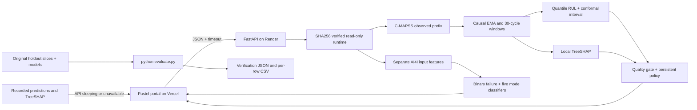

# TimeGuard AI

**Real-model maintenance forecasts, explicit uncertainty, and an auditable reason to act.**

[](https://time-guard-ai.vercel.app/)
[](https://timeguard-ai-api.onrender.com/docs)
[](https://timeguard-ai-api.onrender.com/health)
[](requirements.txt)
[](https://github.com/likhithayepalagunta-19/TimeGuardAI/actions/workflows/tests.yml)
[](LICENSE)

**Live Frontend Portal:** https://time-guard-ai.vercel.app/

**Live Backend API Docs (Swagger):** https://timeguard-ai-api.onrender.com/docs

**Health Endpoint:** https://timeguard-ai-api.onrender.com/health

Hosting badges link directly to the deployed services; they are navigation badges, not uptime monitors. The Tests badge reflects actual GitHub Actions state.

**Team Name:** **Team Un4seen**

**Members:** **Likhitha Yepalagunta - RUL modeling and validation**, **Keerthi Sree- Data pipeline and stream replay**, **Nandini-Interface and visual explanation**, **Niharika - Integration, evidence and pitch**

**AI Innovation Hackathon 2026:** Track 1 — AI/ML Methodology · Challenge 10: TimeGuard AI — Predicting Machine Failure from Sensor Streams · Intermediate to Advanced.

**Track & Problem:** Track 1 — AI/ML Methodology | Challenge 10: TimeGuard AI

## What it does

Late maintenance can cause outages, while premature alerts waste useful component life. TimeGuard combines a causal sensor pipeline, RUL quantile models, a calibrated prediction interval, local TreeSHAP and persistent alert rules. A separate AI4I manufacturing model diagnoses overlapping failure modes. The two domains share an interface, never training rows or an assumed common machine identity.

The pastel portal offers **live ML inference** and **instant recorded replay**. Offline fallback contains actual precomputed model predictions and TreeSHAP for committed benchmark prefixes. It cannot score arbitrary new inputs. Sensor offsets run through the real model when connected, but invalidate a clean-benchmark coverage claim. Live packet-loss replay causally forward-fills missing sensor/settings rows, holds the last valid forecast on a lost tick and requests review. Offline packet loss emulates delivery loss on the original clean recorded forecasts, without recomputing imputed-window predictions. Operators retain maintenance authority.

## One-command benchmark verification

From a fresh clone with Python 3.12 and an activated environment, install dependencies and run the single-command evaluator:

```bash
pip install -r requirements.txt
python evaluate.py
```

No API keys, download, training, notebook or raw training dataset is required. The command verifies SHA256 checksums, recomputes results on **100 original official FD001 test endpoints** and **2,000 original AI4I holdout rows**, checks benchmark parity and raw-prefix feature parity on the three replay engines, prints terminal tables, and writes:

- `reports/verification.json` — metrics, protocol, versions, parity status.
- `reports/verification_metrics.csv` — combined metric table.
- `reports/verification_rul_predictions.csv` — every engine's predictions and labels.
- `reports/verification_ai4i_predictions.csv` — every held-out row's probabilities and labels.

A parity mismatch or missing/corrupted artifact returns a nonzero exit code. The evaluator does not retrain, change thresholds, or recalibrate on the revealed test set. Frozen endpoint features make evaluation compact; the three raw replay prefixes additionally exercise causal preprocessing. Historical baseline values below are from the original training run, not a re-evaluated baseline model.

## Quick start

Python 3.12 is the reference runtime. Model-compatible numerical packages are pinned in `requirements.txt`.

```powershell
git clone https://github.com/likhithayepalagunta-19/TimeGuardAI.git
cd TimeGuardAI
python -m venv .venv
.\.venv\Scripts\Activate.ps1
python -m pip install -r requirements.txt
python evaluate.py
python -m uvicorn api.main:app --host 127.0.0.1 --port 8000
```

Open **http://127.0.0.1:8000** for the complete portal, **/docs** for the typed API explorer and **/health** for readiness. The same API and static code run locally and in deployment.

For offline-only use, open `portal/index.html` directly or double-click `RUN_DEMO.cmd`. Recorded data is bundled as JavaScript so `file://` use does not need a fetch or an internet connection. For the older optional Streamlit workbench, install `requirements-streamlit.txt` and run `RUN_STREAMLIT.cmd`.

Canonical local checkout: `C:\Users\likhi\OneDrive\Documents\TimeGuard`. Git remote: `https://github.com/likhithayepalagunta-19/TimeGuardAI.git`.

## Live presentation behavior

- The Turbofan Monitor opens on engine 20 with recorded historical predictions through **cycle 80**. **⚡ Fast Demo Play** selects engine 20 and replays **verified model outputs from cycle 80 to 180 in four seconds** for presentation speed. This is labeled recorded playback, not 100 live API inferences; regular connected stepping uses live inference.
- TreeSHAP explains the fitted model. Sensor names in the panel are **display aliases for underlying C-MAPSS sensors**, with raw IDs preserved in hover tooltips and attribution payloads. The aliases are not validated physical metadata and contributions do not establish physical root causes. See the [technical dossier](docs/TECHNICAL_DOSSIER.md) for the distinction.
- **Export CSV** downloads an **inference and decision audit log for maintenance review**. It does not create or dispatch a work order, control equipment, or replace human authorization.
- The header status pill opens backend settings. The information icon beside the conformal interval opens provenance and coverage details. API timeouts fall back to labeled recorded outputs; unsupported custom inputs are not assigned invented probabilities.
- Follow the [3:30 Loom demo script](docs/DEMO_SCRIPT.md) for the deployed walkthrough, stress test and reproducibility close.

## Architecture



## Methodology

- **Causal preprocessing:** per-engine EMA alpha 0.25, 30-cycle trailing last/mean/std/min/max/slope features and operating settings. No centered smoothing, future cycle or lifespan enters an inference feature.
- **RUL:** four gradient-boosted quantile regressors at .05, .20, .50 and .95. Training labels are capped at 125 cycles. Engine-separated partitions are 60 fit / 20 calibration / 20 validation, recorded in `reports/rul_engine_splits.json`.
- **Conservative estimate:** $\tau = 0.20$ corresponds to a **4:1 late-vs-early linear cost penalty**. On the fixed benchmark it reduces late RUL overestimates from **65% to 28%**. It is a decision quantile, not the NASA scoring function or an evaluated industrial savings model. NASA S-score is a separate asymmetric evaluation metric; there is no invented “NASA model.”
- **Uncertainty:** held-out calibration endpoints supply a finite-sample conformal correction to outer quantiles, calibrated against raw RUL. Ordinary exchangeability assumptions limit the nominal marginal coverage claim.
- **Explanations:** TreeSHAP runs on the actual fitted median model and aggregates temporal features back to sensors. Signed contributions are measured in RUL cycles and are not proof of physical causality.
- **Alerting:** three lower-bound crossings trigger planning, five safe cycles above a recovery margin clear it. Requests reconstruct state from the observed prefix, preventing cross-user alert contamination. Bad telemetry enters review.
- **AI4I:** six physical/type base inputs plus temperature gap, mechanical power and wear-load product. Balanced forests predict binary failure and five independent mode labels. IDs and all targets are excluded from features. Outputs are uncalibrated probabilities.

## Exact benchmark results

Reproduced by `python evaluate.py`; full precision is saved in `reports/verification.json`. **Loom headline figures: median raw RMSE 14.90 cycles and NASA S-Score 398.78.** The table retains additional precision to match the evaluator.

| FD001 measure, 100 official endpoints | Historical squared-error baseline | Median RUL | Conservative τ=.20 |
|---|---:|---:|---:|
| RMSE, raw cycles | 14.21497 | 14.90066 | 17.62185 |
| RMSE, labels capped at 125 | 13.04592 | 14.08180 | 15.80857 |
| NASA S-score, raw labels, lower is better | 308.42161 | 398.77984 | 418.70838 |
| Any positive RUL overestimate | 62% | 65% | 28% |

Nominal **90%** intervals achieve **84/100 = 84%** empirical official-test coverage, with **54.27088 cycles** mean width. Validation coverage was 90%. **This six-percentage-point empirical calibration gap means the test coverage target is missed.** A conservative decision reduces late estimates but worsens RMSE and NASA score. The baseline remains better on those accuracy metrics.

| AI4I target, fixed threshold .5 | Precision | Recall | F1 | PR-AUC | Positive support |
|---|---:|---:|---:|---:|---:|
| Machine failure | .94915 | .82353 | .88189 | .88241 | 68 |
| TWF | 0 | 0 | 0 | .07236 | 10 |
| HDF | .93103 | .93103 | .93103 | .94550 | 29 |
| PWF | 1 | 1 | 1 | 1 | 13 |
| OSF | 1 | 1 | 1 | 1 | 16 |
| RNF | 0 | 0 | 0 | .03214 | 4 |

AI4I uses the original binary-stratified random 80/20 split. Synthetic row dependence, rule-generated targets and small minority supports limit generalization. TWF/RNF recall is zero at this threshold.

Historical warm **model-only** four-estimator latency: p50 **4.35 ms**, p95 **7.92 ms** on Intel64 Family 6 Model 186 Stepping 3, Python 3.12.14, scikit-learn 1.9.1. It excludes features, SHAP, HTTP and UI. API responses separately report observed request inference duration. No Render SLA or industrial savings are claimed.

## Manufacturing quick-test presets

These are individual **uncalibrated model probabilities for the exact UI inputs**, not holdout recall, accuracy or guaranteed fault diagnoses. Clicking a chip updates sliders and immediately calls `/api/diagnose/ai4i` when live. Arbitrary custom inputs require the live API; offline fallback only scores exact recorded benchmark presets.

| UI preset | Type | Air / process temperature (K) | Speed (rpm) | Torque (Nm) | Wear (min) | Demonstrated model score |
|---|---|---|---:|---:|---:|---|
| Safe Baseline | L | 300 / 310 | 1500 | 40 | 50 | Low binary failure score: 0.0% for this input |
| Trigger Heat Dissipation (HDF) | L | 302 / 310 | 1350 | 50 | 50 | HDF approximately **97.5%** |
| Trigger Overstrain / Tool Wear (OSF) | L | 300 / 310 | 1500 | 85 | 250 | OSF approximately **91.9%**; TWF approximately 21.9% |

Modes are independent and may overlap. **Tool-wear (TWF) and random-failure (RNF) recall remain constrained: both are zero at the default 0.5 threshold on this holdout.** The overstrain preset does not promise high TWF probability, and low scores are not proof of safe operation.

## API contract

| Endpoint | Contract |
|---|---|
| `GET /health` | 200 only when verified models + TreeSHAP are ready; otherwise 503. Returns model version, artifacts and benchmark summary. |
| `GET /api/engines` | Three replay engines (1, 20, 81), available cycle ranges and manufacturing presets from held-out rows. |
| `POST /api/predict/rul` | Engine/cycle or 30–400 contiguous observed rows, optional per-sensor offsets, packet loss and maintenance horizon. Returns median/decision RUL, interval, quality, policy and local attribution. |
| `POST /api/diagnose/ai4i` | Physical manufacturing values and L/M/H type. Returns binary probability plus non-exclusive TWF/HDF/PWF/OSF/RNF probabilities. |

```json
{"engine_id":20,"cycle":60,"offsets":{"s4":10},"packet_loss":false,"horizon":45,"explain":true}
```

```json
{"type":"L","air_temperature":300,"process_temperature":310,"rotational_speed":1500,"torque":40,"tool_wear":100}
```

Custom `observations` use the exact 26 C-MAPSS columns listed in the technical dossier. Provide the observed prefix to preserve EMA history; a bare trailing window initializes EMA at its first supplied measurement and is a different input contract. Offsets apply to the last five supplied observations. Invalid payloads return 422, unavailable demo engines 404, missing models 503. The backend never returns synthetic predictions when unavailable.

CORS is explicitly `allow_origins=["*"]` with credentials disabled, as requested. This is a public demonstration API, not an authenticated factory control system. It stores no submitted telemetry. Production private telemetry requires authentication, admission/rate limits, narrower origins and deployment-specific operational validation.

## Deployment: current services and redeployment

**Render** (after connecting your GitHub account):

1. Render Dashboard → **New + → Blueprint**.
2. Select **likhithayepalagunta-19/TimeGuardAI** on `main` and continue.
3. Review the free web service from `render.yaml`, then **Deploy Blueprint** (button may say **Apply**).

The Blueprint uses `pip install -r requirements.txt`, then `uvicorn api.main:app --host 0.0.0.0 --port $PORT --workers 1`, Python 3.12.14, single-thread BLAS and `/health`. No model download/training runs at boot. Wait for readiness and copy the service's actual HTTPS URL.

**Vercel** (after connecting your GitHub account):

1. Vercel Dashboard → **Add New → Project**.
2. **Import TimeGuardAI**, keeping repository root `.`.
3. Click **Deploy**. The root `vercel.json` explicitly builds only `portal/**` with the static builder and maps `/` to its index, so the Python API does not become a Vercel Function.

**Connect the two services:** open the [live portal](https://time-guard-ai.vercel.app/), click the top-right backend status/settings pill, enter `https://timeguard-ai-api.onrender.com` and click **Connect / retry**. The URL is stored in that browser. For a shareable judge link, append `?api=<URL-encoded-Render-URL>`. For a deploy-wide default, set `window.TIMEGUARD_API_URL` in `portal/api-config.js` and push. No secret is needed or stored. Sleeping API requests time out and switch to labeled recorded replay; use Connect / retry after the service wakes.

The deployed portal, Swagger documentation and health URLs are listed above. Deployment configuration enables redeployment; it does not establish an uptime, cold-start or latency guarantee. [Render Blueprint documentation](https://render.com/docs/blueprint-spec), [Vercel static configuration](https://vercel.com/docs/project-configuration/vercel-json).

## Repository and artifact boundaries

```text
api/                         FastAPI typed HTTP boundary
src/timeguard/               Features, conformal correction, policy, shared model runtime
models/                      Tracked joblib bundles + SHA256 manifest
data/demo_slice/             Tracked original holdouts, replay prefixes and AI4I presets
data/raw/                    Ignored training/download archives, optional for retraining
portal/                      Pastel UI + real-model prerecorded fallback
evaluate.py                  Zero-config verification after dependencies are installed
scripts/                     Download, train, explain, explicit demo-packaging tools
tests/                       Causal, model-integrity, policy and real endpoint checks
reports/                     Published results + reproducible verification artifacts
docs/                        Research dossier, screening copy, final copy, PPT/PDF and images
.github/workflows/tests.yml  Linux tests + evaluation + verification artifact upload
render.yaml / vercel.json    Split hosting configuration
```

The approximately 10 MB trained models are committed as requested. Only trust model files from this repository: joblib deserialization executes Python data structures and is not a format for untrusted user uploads. SHA256 checks detect corruption against the trusted manifest, not a malicious change to both model and manifest. `scripts/package_demo.py` is an explicit maintainer operation using raw data; inference/evaluation never invokes it.

## Verification

```powershell
python -m pytest -q
python evaluate.py
node --check portal/app.js
```

CI runs those commands on Linux and uploads verification reports. Endpoint tests exercise real weights and TreeSHAP, missing first packets, stale holds, injected shifts, custom-prefix parity, independent alert state, request validation, CORS and unavailable/corrupted artifacts. See [validation record](docs/VALIDATION.md).

## Deliverables and demo

- [Stage 1 form copy](docs/STAGE1_SUBMISSION.md), [Stage 2 copy](docs/STAGE2_SUBMISSION.md), [technical dossier](docs/TECHNICAL_DOSSIER.md).
- [Editable pitch deck](docs/presentation/TimeGuardAI_Stage1_Final.pptx), [PDF](docs/presentation/TimeGuardAI_Stage1_Final.pdf). These record the earlier screening stage; the live portal supersedes their synthetic demo.
- [Demo script](docs/DEMO_SCRIPT.md), [historical UI images](docs/screenshots/TimeGuard_UI_Images.zip).
- Updated UI captures are saved under `docs/screenshots/live-portal/` after browser verification. The live hosted portal is linked above; a public Loom recording URL has not been supplied.

## Limitations and next research steps

No factory deployment, certified safety function, measured downtime saving or evaluated maintenance-cost simulator. C-MAPSS is simulated aerospace data, AI4I is synthetic manufacturing data, and replay ticks are accelerated cycles rather than service hours. FD001 contains one operating condition and one degradation mode. There is no demonstrated robustness guarantee under drift. Calibration improvement requires a preregistered fresh validation protocol, not tuning to this revealed test set. PRONOSTIA physical-bearing validation, censored survival modeling and industrial CMMS/IoT integration are future work.

## References, comparison and licensing

- [NASA C-MAPSS](https://data.nasa.gov/dataset/cmapss-jet-engine-simulated-data), Saxena et al., *Damage Propagation Modeling for Aircraft Engine Run-to-Failure Simulation*, PHM 2008. Original catalog and source hashes are recorded in `reports/data_provenance.json`.
- [UCI AI4I 2020](https://archive.ics.uci.edu/dataset/601/ai4i+2020+predictive+maintenance+dataset), DOI 10.24432/C5HS5C, CC BY 4.0, and Matzka (2020). Committed holdout slices are attributed derivatives of this synthetic dataset.
- [Conformalized Quantile Regression](https://arxiv.org/abs/1905.03222), Romano, Patterson and Candès, 2019.
- [SHAP TreeExplainer](https://shap.readthedocs.io/en/latest/generated/shap.TreeExplainer.html).
- [SemiRestore](https://github.com/akhileshkancharla/SemiRestore) was inspected for its checksum-gated artifacts, readiness contract, separation of model/platform code, endpoint tests and reproducible handoff documentation. TimeGuard implements those patterns for its own models; no claim of equivalent restoration behavior or testing breadth is made.
- Code: [MIT](LICENSE). External datasets retain their own terms. AI assistance contributed to planning, code and documents; the team must follow the organizer's disclosure rules.
